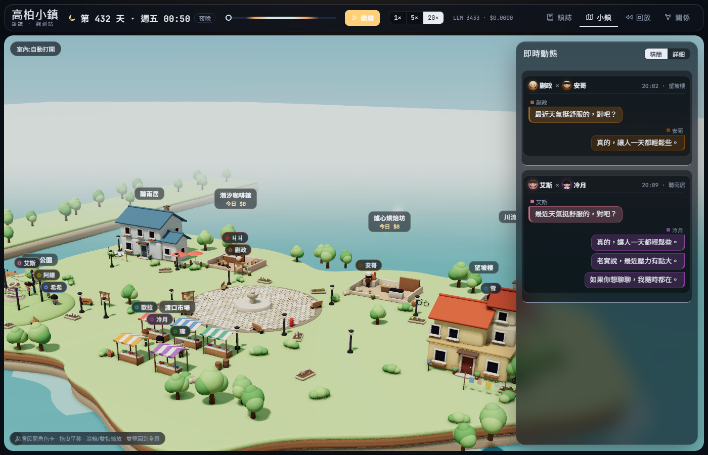
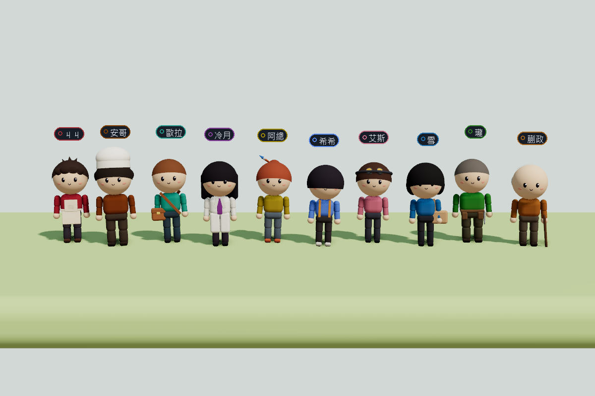
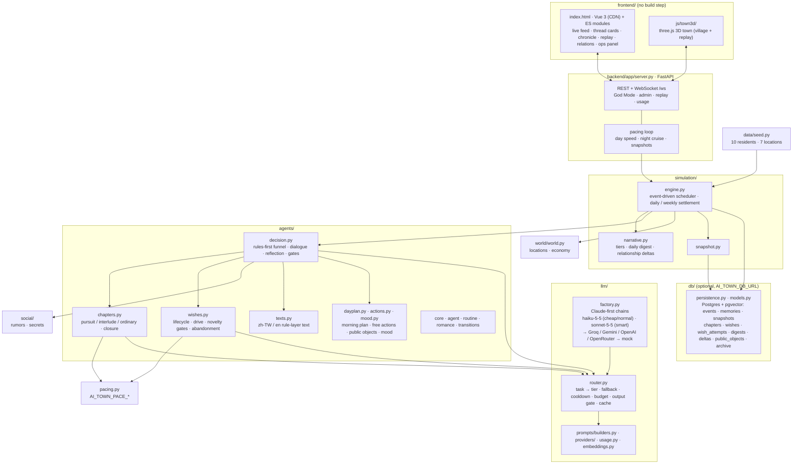

# 高柏小鎮 · Gaobo Town

> **English summary.** A generative multi-agent social simulation. Ten LLM-driven
> residents live in a small town, written natively in Traditional Chinese. Each one is
> always inside a *life chapter*. They grow their own private wishes, chase them, give
> up on some (how readily depends on personality), and close them with a reflection.
> Secrets get confided and leaked, rumors spread and get confronted, and romances start.
> Nobody directs the story: the world runs on its own, and rules settle outcomes before
> any model is asked. Claude (Haiku / Sonnet) is first in the model chain, a free mock
> provider runs everything at zero cost, and Postgres + pgvector persistence lets the
> town survive restarts.

高柏小鎮是一個生成式多代理社會模擬。十位居民各自活在「人生章節」裡:有正在追的事、追完之後的空白期、平凡日子。
他們會從自己的經歷長出願望,為它奔走、受挫、在個性允許的範圍內放棄,事情了結時寫下一段收束反思,翻到下一頁。
沒有導演,沒有劇本:世界自己運轉,你只是在旁邊看。

| 白天 | 夜晚(右側為即時動態欄的對話串卡片) |
|---|---|
|  |  |



<sub>截圖取自 mock 驗證環境;白天那張的居民位置是為了拍攝擺放的,實際運行時由即時資料驅動。</sub>

---

## 功能(已實作、已在 main)

**居民與人生**
- **十位居民**(`data/seed.py`):ㄐㄐ、安哥、歐拉、冷月、阿總、希希、艾斯、雪、瓏、蒯政,住在七個地點(兩棟住家、咖啡館、烘焙坊、市場、事務所、公園)。
  每人有年齡、職業、特質、說話風格、性別、盡責度、戀愛傾向;作息刻意設計成會在路上相遇。
- **繁中原生生成**(`agents/texts.py`):`AI_TOWN_LANG=zh-tw` 時,所有記憶、敘事、規則層文字都直接以繁體中文寫成,不經翻譯。
  中文的字詞比對用 CJK 二字組,讓「共同字詞」類規則在中文下照樣成立。
- **人生章節**(`agents/chapters.py`):每位居民永遠處在一個章節:`pursuit`(在追一件具體的事)、
  `interlude`(追完後的空白期)、`ordinary`(平凡日子)。章節收束時,自我敘事、記憶權重、信念與 prompt 脈絡一起翻頁。
- **自長的願望**(`agents/wishes.py`):空白期結束、或平凡日子裡按節奏擲骰時,居民會從自己的經歷長出一個私人願望(smart tier 的罕見呼叫)。
  新願望要過兩道新穎度關卡:**embedding 相似度**(餘弦 > 0.85 視為重複)和**結構新穎度**(同一個人、同樣的行動組合)。
  每次生成嘗試都記進 `wish_attempts` 帳本。
- **進度只來自真實事件**:願望的需求計數只會因為模擬真的發生了對應事件而前進;驅力只會在作息本來就空出來的時段提出建議。
- **放棄的摩擦**:挫折來自「連續、不同天」的受阻;放棄門檻依盡責度、已經背負多久(沉沒成本)和願望規模個人化。
- **收束反思**:一個 pursuit 結束(完成 / 失敗 / 放棄)時,一次 smart tier 呼叫寫下傳記句與情緒餘韻;模型失敗時用模板句,收束不會卡住。
- **願望隱私**:願望的標題、敘述、動機只屬於本人,不會進入其他居民的 prompt、記憶、公開事件或鎮誌。

**社會系統**
- **秘密**:依信任度向人傾訴 → 可能被洩漏成謠言 → 對質 → 釋懷。
- **謠言**:散播 → 轉述走樣 → 傷害關係 → 當事人找上門對質 → 了結(了結後停止傳播)。
- **戀愛線**(`agents/romance.py`):獨立於友誼 / 信任的單向數值;暗戀(私密)→ 告白 → 交往 → 正式在一起,全由規則決定,模型只演出已決定的場面。
- **約見**:居民會主動約人在某地見面,對方可以婉拒。
- 關係(友誼 / 信任 / 衝突)、里程碑、人生轉變(辭職、到店裡上工、自由接案)、經濟(薪資、店家營收、週結算)、天氣、慶典、設備故障與維修。

**活化:對話、自由意志、行動、心情**
- **逐輪對話**(`agents/decision.py`):一句一次呼叫,每一句只用說話者自己的脈絡生成,包括對對方的記憶、最近掛心的事、自己的願望全文、私事、心情和對對方的看法,再加上目前為止的逐字稿。
  雙方掌握的資訊不對等;模型可以自己結束對話,上限 8 句;傾訴、對質、告白至少 4 句。日常對話走 Haiku,傾訴、對質、告白、牽涉願望的對話走 Sonnet。
  後果由規則從結構化欄位讀出:轉告的消息變成聽者的記憶;雙方都說出口的見面計畫變成真的約定(守約或落空都會被記住);一方轉身走人就是「不歡而散」,雙方關係下降。
- **起床微決策**(`agents/dayplan.py`):每天換日時,每位居民用一次 Haiku 呼叫決定「今天想怎麼過」。「沒什麼特別」是合法而且常見的答案。
  規則決定其餘的事:今天的打算優先於願望驅力,願望驅力優先於作息;睡眠永遠不動。去別人家不行,錢不夠不行。想翹班時,翹班意願要超過本人的盡責度才成立;店主翹班,店就關一天,沒有營收,上門的客人會記得。
- **自由行動與公共物件**(`agents/actions.py`):晨間打算最多能附帶 2 件自己想做的小事。到了時間由規則判定成敗。
  失敗(錢不夠、店沒開、下雨、太累、錯過時間)本身就是一個事件,也會留下「想做但沒做成」的記憶。成功時會真的扣錢、留下本人的記憶,在場的人有機會看見。
  如果留下了東西,就成為那個地點的公共物件:寫進 `public_objects`,出現在之後那裡的每個場景(描述會隨時間淡化),經過的人有機會記住它。
- **心情**(`agents/mood.py`):在原有心情標籤之下,另有一個 -1..1 的連續值,由對話感受、不歡而散、守約或落空、願望收束、當天營收推動,每晚減半,並記住最近一個原因。它會進入對話脈絡、起床決策和願望生成。

**敘事層**(`simulation/narrative.py`,純規則、不呼叫模型)
- 每個事件依動詞標成 `major` / `notable` / `ambient`(例如願望誕生、章節轉折、對質、告白屬 major)。
- **每日摘要**:每天結算時,把當天的 major / notable 事件寫成一句話(`/api/digests`)。
- **關係變化紀錄**:每對關係每天的變動量(`/api/relationship_history`)。

**節奏與成本**
- **節奏集中管理**(`backend/app/pacing.py`):願望生成機率、間隔、期限、空白期長度、每日對話上限,全部可用 `AI_TOWN_PACE_*` 覆寫。
- **LLM 是最後手段**:事件驅動排程(睡著的居民零成本)、規則優先的決策漏斗、決策快取;整座小鎮都睡著時零呼叫,夜間自動快轉。
- **預算上限**:`AI_TOWN_BUDGET_USD` 花到上限後,所有呼叫一律落到免費的 mock。
- **寧慢勿假**:對話與反思整條鏈失敗時不會端出罐頭句,而是稍等一下再把整條鏈重跑一次;輸出還要過品質關卡(空字串、敷衍的 "ok"、截斷的 JSON、中文亂碼、代名詞指涉錯誤)。

**持久化**(選用,設定 `AI_TOWN_DB_URL`)
- Postgres + pgvector:事件、記憶(向量檢索)、LLM 花費帳本、世界快照、章節 / 願望 / 生成嘗試帳本、每日摘要、關係變化、公共物件、破壞性操作前的 `snapshot_archive` 備份。
- 快照與續跑:重啟後從上次的快照接著跑;舊快照缺少新欄位時照樣載入。
- 紀元封存:`simulation_runs.archived` 標記的 run 唯讀、不再續跑,但仍可回放。

**介面**(`frontend/`,不用 build)
- Vue 3(CDN)+ ES modules + three.js;主頁 `/` 是整座 3D 小鎮(陶土微縮風格,日夜隨模擬時鐘、有人在屋裡時屋頂掀開成剖面、十位居民各帶一件職業小物),玻璃面板的即時動態欄浮在上面。2D 像素地圖已退役。
- 鏡頭:拖曳平移、滾輪縮放、右鍵軌道旋轉(俯仰 20°–70°)、WASD / 方向鍵依視角平移;點名牌跟隨居民。點居民開一張可拖曳的浮動角色卡。
- **即時動態欄與對話串卡片**:一段對話就是一張卡片(雙方、時間、地點、輪流的對話泡泡,同場的傾訴 / 對質也附在卡片裡)。
- 鎮誌、回放(拖時間軸重演歷史)、關係圖、居民檢視器。
- **營運面板**(角落的小按鈕):上帝模式(謠言、秘密、天氣、慶典、故障、植入願望、手動收束章節)與維護端點;破壞性操作預設 dry-run。

---

## 快速開始

### 1. 免費 mock 模式(不需金鑰、不需資料庫)

```bash
pip install -r requirements.txt
python scripts/run_day.py                 # 無頭跑一天,印出當天事件(確定性 mock)
uvicorn backend.app.server:app            # 從 repo 根目錄啟動,開 http://localhost:8000
```

`AI_TOWN_LIVE` 沒設(或設 `0`)時,一律走內建的確定性 mock provider,零成本、記憶體內運行。
要看繁中原生小鎮,另外設 `AI_TOWN_LANG=zh-tw`(mock 也會產出中文)。

### 2. 本機 Postgres(pgvector,Docker)

正式運行的小鎮把資料庫放在本機 Docker 容器裡,完整步驟(含 dump / restore)見 [`docs/deploy.md`](docs/deploy.md#local-postgres-the-live-home-machine-database):

```bash
docker volume create aitown-pgdata
docker run -d --name aitown-pg --restart unless-stopped \
  -e POSTGRES_USER=aitown -e POSTGRES_DB=aitown -e POSTGRES_PASSWORD=<password> \
  -v aitown-pgdata:/var/lib/postgresql/data \
  -p 127.0.0.1:5433:5432 \
  pgvector/pgvector:pg17
```

接著在 repo 根目錄的 `.env` 設 `AI_TOWN_DB_URL=postgresql+asyncpg://aitown:<password>@127.0.0.1:5433/aitown`。
伺服器啟動時會自己 `CREATE EXTENSION IF NOT EXISTS vector` 並建表。
(`docker-compose.yml` 裡另有一個 `pgvector/pgvector:pg16` 的 `db` 服務,是給容器測試用的,和上面這個互不衝突。)

### 3. 接上真的模型

在 `.env`(只放本機,不進 repo)設 `AI_TOWN_LIVE=1` 和 `ANTHROPIC_API_KEY`。
`backend/app/llm/factory.py` 會讓 Claude 排在每條鏈的最前面,原本的鏈整條留在後面當備援:

| tier | 首選 | 備援(依序,有金鑰才加入) |
|---|---|---|
| cheap / normal | `claude-haiku-5-5` | Groq / Gemini / OpenAI → OpenRouter → mock |
| smart(反思、章節收束、願望生成) | `claude-sonnet-5-5` | Groq 70b / Gemini / OpenAI → OpenRouter → mock |

在繁中模式下,對話、反思等自由文本任務會改走中文可靠的鏈(Gemini → Gemini 2.0 → Groq 70b → OpenRouter 中文模型 → mock),Claude 一樣在最前面。
設了 `AI_TOWN_PAID=1` 加 `OPENROUTER_API_KEY` 時,對話、反思、章節收束、願望生成這幾條鏈會在 Claude 之後、免費層之前插入 DeepSeek v4 flash 和第二付費模型;便宜的結構化任務只把 DeepSeek 接在鏈尾。

### 環境變數

全部選用;什麼都不設就是 mock + 記憶體模式。`.env` 放在 repo 根目錄(真正的環境變數優先)。

| 變數 | 用途 | 預設 |
|---|---|---|
| `AI_TOWN_LIVE` | `1` = 使用真實 LLM provider;其他值或未設 = mock | 未設 |
| `ANTHROPIC_API_KEY` | Claude 排在每條鏈最前面(Haiku / Sonnet) | — |
| `GROQ_API_KEY` / `GEMINI_API_KEY` / `OPENAI_API_KEY` | 備援 provider | — |
| `OPENROUTER_API_KEY` | OpenRouter 備援;`AI_TOWN_PAID` 的前提 | — |
| `OPENROUTER_MODEL` / `OPENROUTER_MODEL_ZH` | OpenRouter 英文 / 中文備援模型(中文設空字串可關掉) | `openrouter/free` / `google/gemma-4-26b-a4b-it:free` |
| `AI_TOWN_PAID` | `1` = DeepSeek v4 flash + 第二付費模型排在免費層前面(需 OpenRouter 金鑰) | 未設 |
| `AI_TOWN_ZH_SECOND_MODEL` | `AI_TOWN_PAID` 時的第二付費模型 | `moonshotai/kimi-k2.6` |
| `AI_TOWN_LANG` | 生成語言;`zh-tw` = 繁中原生小鎮 | `en` |
| `AI_TOWN_BUDGET_USD` | 花費上限,到了全部落到 mock;`<=0` = 不設上限 | `10.0` |
| `AI_TOWN_DIALOGUE_CAP` | 每個模擬日的對話上限(僅 live;`0` = 不限) | `AI_TOWN_PACE_DIALOGUE_CAP`(20) |
| `AI_TOWN_MEETUPS` | `1` = mock 模式也啟用約見(live 一律啟用) | 未設 |
| `AI_TOWN_DB_URL` | Postgres + pgvector(`postgresql+asyncpg://…`);未設 = 記憶體內 | 未設 |
| `AI_TOWN_RESUME` | `0` = 忽略最新快照,從 Day 1 開新 run | `1` |
| `AI_TOWN_DAY_SPEED` | 白天速度(每真實秒的模擬分鐘數) | `1` |
| `AI_TOWN_NIGHT_SPEED` | 全鎮入睡時的夜間快轉速度 | `20` |
| `AI_TOWN_UNATTENDED` | `1` = 沒人在看也繼續跑(並錄下歷史) | `0` |
| `AI_TOWN_UNATTENDED_SPEED` | 無人觀看時的巡航速度 | `2` |
| `AI_TOWN_SYNC_CALL_TIMEOUT` | tick 內 / 同步小呼叫的單一 provider 逾時(秒) | `10` |
| `AI_TOWN_DIALOGUE_PROVIDER_TIMEOUT` | 對話的單一 provider 逾時(秒) | `60` |
| `AI_TOWN_DIALOGUE_TIMEOUT` | 對話外層保險逾時的基數(秒;逐輪對話乘上 句數上限 ÷ 2) | `90` |
| `AI_TOWN_DIALOGUE_CONCURRENCY` | 同時生成中的對話數 | `6` |
| `AI_TOWN_DIALOGUE_RETRY_ROUNDS` / `_WAIT` | 對話整條鏈失敗後的重跑輪數 / 等待秒數 | `2` / `30` |
| `AI_TOWN_REFLECT_RETRY_ROUNDS` / `_WAIT` | 反思的重跑輪數 / 等待秒數(用盡則略過,不端罐頭) | `2` / `20` |
| `AI_TOWN_GATE_DIAG` | `1` = 把品質關卡的拒絕原因寫進 log | 未設 |

**節奏(`AI_TOWN_PACE_<NAME>`,見 `backend/app/pacing.py`)**

| 變數 | 用途 | 預設 |
|---|---|---|
| `AI_TOWN_PACE_GENERATION_BASE_P` | 沒有進行中大願望時,一次生成嘗試的機率 | `0.80` |
| `AI_TOWN_PACE_GENERATION_DECAY` | 全鎮每多一個進行中大願望就乘一次的衰減 | `0.75` |
| `AI_TOWN_PACE_ORDINARY_EVERY` | 平凡日子裡兩次生成嘗試的最短間隔(模擬日) | `3` |
| `AI_TOWN_PACE_SPAN_MAJOR` / `_SPAN_MINOR` | 大 / 小願望的建議期限(模擬日) | `14` / `7` |
| `AI_TOWN_PACE_INTERLUDE_MIN` / `_INTERLUDE_MAX` | 章節收束後空白期長度範圍(模擬日) | `2` / `4` |
| `AI_TOWN_PACE_DIALOGUE_CAP` | 每日對話上限(live) | `20` |
| `AI_TOWN_PACE_DIALOGUE_MAX_TURNS` / `_DIALOGUE_INTIMATE_MIN_TURNS` | 每場對話句數上限 / 傾訴、對質、告白的最少句數 | `8` / `4` |
| `AI_TOWN_PACE_DIALOGUE_TELLS_MAX` | 一場對話最多留下幾筆「誰跟我說」記憶(每位說話者一筆) | `2` |
| `AI_TOWN_PACE_DIALOGUE_TENSE_TRUST_MARGIN` | 信任度離傾訴門檻多近就改走 Sonnet | `5` |
| `AI_TOWN_PACE_DIALOGUE_STORM_OFF_FRIENDSHIP` / `_TRUST` | 不歡而散時雙方的友誼 / 信任降幅 | `4` / `3` |
| `AI_TOWN_PACE_MOOD_*` | 心情權重:`TALK_WEIGHT` 0.4、`CONFLICT_WEIGHT` 0.3、`DAILY_DECAY` 0.5、`STORM_OFF` 0.3、`PROMISE_KEPT` 0.2、`PROMISE_MISSED` 0.15、`WISH_COMPLETED` 0.4、`WISH_FAILED` 0.3、`WISH_ABANDONED` 0.05、`REVENUE` 0.15 | 見左 |
| `AI_TOWN_PACE_DAYPLAN_MAX_SLOTS` / `_MAX_SLOT_HOURS` / `_STUCK_DAYS` | 晨間打算最多改幾段、每段最長幾小時、追求章節幾天沒進展算卡住 | `3` / `4` / `3` |
| `AI_TOWN_PACE_FREE_ACTIONS_PER_DAY` / `_FREE_ACTION_MAX_COST` | 每天最多幾件自由行動 / 一件最多花多少錢 | `2` / `30` |
| `AI_TOWN_PACE_ACTION_WITNESS_P` / `_OBJECT_NOTICE_P` | 在場者看見行動 / 路過者記住公共物件的機率 | `0.5` / `0.6` |
| `AI_TOWN_PACE_OBJECTS_PER_PLACE` | 每個地點場景裡最多顯示幾件公共物件(更舊的仍留在資料庫) | `8` |
| `AI_TOWN_PACE_FRESH_DAYS` | 完成的東西被描述成「新」的天數 | `7` |

**遺留變數(目前不起作用)**:顯示層翻譯已退役(`server.py` 的 `TRANSLATION_RETIRED = True`,繁中原生時代直接寫中文),
`AI_TOWN_TRANSLATE_MODEL`、`AI_TOWN_TRANSLATE_RETRY_MAX`、`AI_TOWN_TRANSLATE_RETRY_WAIT` 雖然還會被讀取,但翻譯流程已經不會執行到,只剩舊紀元的翻譯快取還在回應。

### 測試

```bash
python -m unittest discover tests -v
```

---

## 架構



`scripts/` 裡是一次性的維運腳本(全部預設 dry-run,`--execute` 才真跑):`archive_run.py`(封存紀元)、
`backfill_chapters.py`、`backfill_chapter_ledger.py`、`reclose_chapter.py`、`fix_wish_born.py`,以及無頭單日模擬 `run_day.py`。

---

## 歷史

先前的「正式紀元」(run `f2024443…`,Day 1–132)已用 `scripts/archive_run.py` 封存(`simulation_runs.archived`),唯讀但仍可回放。
目前運行的是從 seed 重新開始的新紀元(run `7b977300…`):繁中原生文字、Claude 優先的模型鏈、敘事層,節奏也調快了一檔。

---

## 路線圖

- **第三階段剩餘工作**:結構化猜測、謠言 × 願望的交互。
- **小鎮報紙**。

---

## 文件

- [`docs/watch-reports/`](docs/watch-reports/):依日期歸檔的觀察報告、診斷與交付紀錄(歷史文件,不回頭改)。
- [`docs/deploy.md`](docs/deploy.md):容器部署、本機 Postgres(pgvector:pg17)、快照續跑與紀元封存。
- [`docs/admin.md`](docs/admin.md):營運 / 上帝模式端點、預設 dry-run 的維護操作,以及從 `snapshot_archive` 復原。
- [`docs/event-contract.md`](docs/event-contract.md):前端與資料庫共用的結構化事件格式、動詞表與敘事分級。
- [`docs/frontend.md`](docs/frontend.md):前端為什麼不用 build、檔案配置、地圖、對話串與 3D 驗證切片。
- [`docs/formal-server-checklist.md`](docs/formal-server-checklist.md):開正式服前定案的人設與地名決策紀錄(2026-08)。

## 致謝

靈感來自 Stanford 的 [Generative Agents](https://arxiv.org/abs/2304.03442) 與 DeepMind 的 [Concordia](https://github.com/google-deepmind/concordia)。
