# 第三紀元點火前收尾報告

- 現紀元 run:`7b977300…`(新紀元),資料截至 **Day 49 08:00**
- 全部改動都已 push 到 main;最後一個程式 commit 是 `016abe7`,最後一支腳本是 `306f3f8`
- 測試:**259 個全綠**,其中包含 4 天繁中 mock 的範圍斷言煙測
- **點火尚未執行,等你說 GO。** 點火三行操作在文末

## 總表

| 項目 | 狀態 | 證據 |
|---|---|---|
| A1 活化:逐輪對話 | ✓ | `87d9e86`、`fb07b17`;測試 `test_dialogue_turns`(16 個);正式環境約 8 個模擬日;[階段 A 報告](2026-11-01-activation-phase-a.md) |
| A1 活化:起床微決策與心情 | ✓ | `74559c9`、`dca1814`、`2dc3819`;測試 `test_dayplan_mood`(18 個);正式環境 44 份晨間打算;[階段 B+D 報告](2026-11-01-activation-phase-bd.md) |
| A1 活化:行動契約與公共物件 | ✓ | `3338be9`、`4e8ebd7`、`494860f`(裁決一:控制他人才擋)、`016abe7`(裁決二:共同行動措辭)、`200e6bd`、`18311ed`、`a8bd69c`;測試 `test_free_actions`(28 個);正式環境:15 件公共物件,其中 3 件單向投遞、1 件已被收件人自己發現 |
| A2 地標描述的時間感 | ✓ | `87d9e86`。「剛完工」類錯誤台詞:活化前 14 句 → 活化後 0 句 |
| A2 Standing aim 退役 | ✓ | `87d9e86`。掃過所有 prompt builder,只有 `character_card` 引用 `profile.goals`,已移除;沒有第三個 seed 錨點 |
| A2 本人願望(含 minor)進本人座位 | ✓ | `87d9e86`。有測試:本人座位看得到全文,對方座位看不到 |
| A2 結構化閘門省錢規則 | ✓ | `5bd66d1` |
| A3 十人量產與合照 | ✓ | `dd441fe`;合照見 `docs/img/residents.png` |
| A3 玻璃 UI 四個頁面 | ✓ | `dd441fe`;下方截圖 |
| A3 2D 退役 | ✓ | `dd441fe`:Pixi 不再載入,`pixmap.js` / `pixelart.js` / `map/town.json`、驗證切片和 `/town3d-preview` 都已刪除 |
| A4 測試隔離 | ✓ | `9ee3ee6`。注入假 key,不讀 `.env`;在沒有 `.env` 的匯出版也驗證通過 |
| A5 全測試綠 + 煙測在範圍內 | ✓ | 259 個測試 OK;`4a0299a` 煙測斷言句數 2–8、沒有卡住的對話鎖、每人每天一次晨間呼叫、全部台詞都是中文 |
| A6 README / docs 對齊 | ✓ | `639d9bb`、`a2cbe1a`。抽查三項:預算預設 `10.0`(`factory._budget_from_env`)、對話上限 `20`(`pacing.DIALOGUE_CAP`)、模型鏈 Haiku / Sonnet 優先(`factory.py`),都與程式一致 |
| B1 浮動角色卡 | ✓ | `dd441fe` |
| B2 軌道旋轉與跟隨 | ✓ | `dd441fe` |
| B3 黑色矩形 | ✓ | `dd441fe`。原因是煙囪的 Sprite 被 GTAO 當成不透明物體;現在透明物件不進 AO 通道 |
| B4 WASD 平移 | ✓ | `dd441fe` |
| B5 維運面板版面 | ✓ | `9efb9c4`。在 1400、1000、390 三種寬度,抽屜開與關都量過,沒有重疊 |
| B6 WASD 速度 | ✓ | `9efb9c4`。速度約為原本的 2.6 倍,和鏡頭距離成正比;常數在 `town.json` 的 `keySpeed` / `keyFast` |
| (追加)角色卡顯示心情與今日打算 | ✓ | `9efb9c4` |
| C1 全機只跑一個 server | ✓ | 見下方「Process 盤點」 |
| C2 守望監控重掛 | ✓ | 已掛在正式 server 上;計數器和 ledger 都在動 |
| C3 `AI_TOWN_GATE_DIAG=1` | ✓ | 從 Day 39 起每次重啟都帶上(和 `AI_TOWN_BUDGET_USD=30` 一樣,啟動時以環境變數帶入;`.env` 讀寫被權限擋住,沒有改) |
| D1 封存演練 | ✓ | 見下方「封存演練」 |
| D2 點火三行 | ✓ | 文末 |
| D3 點火執行 | — | 等你說 GO |

## 統計驗收(對照 Day 31 診斷的基準)

話題分類用的是和診斷報告同一套關鍵詞(粗略:例如「燈」會被「燈座」命中),所以只看趨勢。

| | 基準 D1–39 | A(0.9 日) | B+D(1.4 日) | C(7.3 日) |
|---|---|---|---|---|
| 對話場數 | 682 | 17 | 23 | 143 |
| 含 seed 素材 | 37% | 0% | 13% | 26% |
| 提到光影裝置 | 20% | 0% | 4% | 10% |
| 含新紀元素材 | 51% | 65% | 52% | **73%** |
| 只有寒暄 | 6% | 6% | 13% | 6% |
| 每模擬日成本 | — | $0.465 | $0.378 | $0.437 |
| 非 Claude fallback | — | 0 | 0 | 0 |

- **光影裝置**:C 窗那 10% 是居民在公園把裝置當背景、邊看邊聊(「這裡的光影裝置今天又換了一組」「它的感應好像會跟著人走動的速度變化」),不是把它誤當成剛完工的新聞。「剛完工」類錯誤台詞:活化前 14 句,活化後 0 句。
- **seed 素材回升到 26%**:有一部分是關鍵詞誤命中(「燈座」「價格」這類日常用字);另一部分是雪和 ㄐㄐ 的種子心事(辭職、咖啡館經營)開始經由她們自己說出口,而且說給了對的人。這屬於種子在這個紀元裡被重新消化,不是 prompt 硬塞的錨點。
- **成本**:活化之後合計 $4.12 / 9.6 模擬日 ≈ **$0.43 / 模擬日**,在預期的 $0.5–1 區間內,遠低於 $2 的警戒線。
- **閘門**:`zh_quality` 0、`generation_gender` 0、`wish_novelty_struct` 1、診斷 log 裡 gate-reject 1、ref-reject 0。
- **事件**(C 窗):傾訴 27、對質 1、守約碰面 9、承諾成立 4、承諾落空 1、新願望 12、自由行動 12、公共物件 15、行動失敗 7。另有 173 筆「誰跟我說」記憶、73 筆「看到某人做某事 / 看到某物」記憶。

### 翹班意願 × 盡責度(64 份晨間打算)

| 盡責度 | 居民 | 份數 | 平均翹班意願 | 實際翹班 |
|---|---|---|---|---|
| 0.1 | 歐拉 | 7 | 0.00 | 0 |
| 0.4 | 冷月 | 7 | 0.04 | 0 |
| 0.5 | ㄐㄐ | 7 | 0.19 | 0 |
| 0.5 | 蒯政 | 6 | 0.00 | 0 |
| 0.5 | 瓏 | 6 | 0.13 | 0 |
| 0.7 | 安哥 | 7 | 0.09 | 0 |
| 0.8 | 雪 | 6 | **0.28** | 0 |
| 0.9 | 阿總 | 6 | **0.32** | 0 |
| 1.0 | 艾斯 | 6 | 0.13 | 0 |
| 1.0 | 希希 | 6 | 0.08 | 0 |

- 審計 log 從 Day 43 才開始記錄,所以表中只有 64 份。在那之前,D42 ㄐㄐ(盡責度 0.5、意願 0.6)翹班了一次,咖啡館當天休息。
- 想翹班的意願最高的是雪和阿總,她們正好是最盡責的兩位(0.8、0.9),所以門檻擋住了她們。雪的意願是在說她「被辭職的念頭卡住」;這個差距本身就是故事。
- 盡責度低的歐拉從來不想翹班:他的工作就是到處跑,本來就沒什麼可翹。

### 行動失敗(7 次),逐筆歸因

全部 7 筆的原因都是「時間錯過了」,而且全部發生在對應修正上線之前。修正上線之後(D47 16:36 → D49 08:00),行動失敗 **0 筆**。

| 失敗 | 原因 | 修正 |
|---|---|---|
| D45 ㄐㄐ、安哥、冷月 | 被一場還在生成的對話凍住。在 5× 下,一場 16 分鐘的對話因為等模型生成,凍了約 70 分鐘 | `200e6bd`:被生成延遲吃掉的那段時間裡排定的行動,改成順延 |
| D46 阿總、D47 歐拉 | 行動時段被同地點、排在前面的一般時段蓋住(D46 是順延後落進去) | `18311ed`:行動自己的時段優先 |
| D47 蒯政 | 包在同地點時段裡的行動,在它的開始時刻沒有任何決策點 | `a8bd69c`:「下一段打算開始」也把行動算進去 |
| D47 16:00 阿總 | 同屬「時間錯過了」,發生在兩個修正上線(16:36)之前 | 同上;這一筆沒有逐筆重建當時的打算 |

以上的修正全部有回歸測試,也都驗證過沒修時測試會失敗。

### 公共物件(15 件,D44–48)與單向投遞

節錄:

| 日 | 地點 | 留下的人 | 物件 | 收件人 |
|---|---|---|---|---|
| D44 | 螢火公園 | 瓏 | 一把重新牢固的長椅,椅背上多了一小塊新木條 | — |
| D46 | 爐心烘焙坊 | ㄐㄐ | 一張寫著歡迎安哥來潮汐咖啡館坐坐的小紙條 | **安哥**(D47 05:40 安哥自己路過時發現) |
| D46 | 螢火公園 | 安哥 | 一張寫著「長椅新修好,歡迎坐坐」的手寫小字條 | — |
| D47 | 螢火公園 | 雪 | 一張小紙條,寫著「坐下來的時候,想清楚再走」 | — |
| D48 | 螢火公園 | 雪 | 「不急,慢慢想也可以。」 | — |
| D48 | 川流事務所 | 阿總 | 一張手寫紙條:「下午來川流坐坐?有些心裡的話,想好好跟你說。—阿總」 | **冷月** |
| D48 | 聽雨居 | 歐拉 | 一張手寫小紙條,邀瓏一起坐坐聊聊 | **瓏** |
| D48 | 渡口市場 | 艾斯 | 一張手寫小紙條:今天走過市場,看見大家留下的字,覺得心裡輕了些 | — |

- 公園那張長椅成了一連串物件的起點:瓏修好它,5 個路人記住它;安哥在旁邊留了字條,雪連續兩天在那裡留下寫給自己(也寫給別人)的話。
- 艾斯在市場留下的字條,寫的是「看見大家留下的字」。物件開始引出新的物件。
- 安哥發現紙條之後,記憶裡只有「發現 ㄐㄐ 留給我的紙條」。要不要去咖啡館,交給他自己的晨間決策和對話,規則沒有替他決定任何反應。

### 契約修正前後:行動通過率

| 日 | 規則 | 提案 | 通過 | 被擋原因 |
|---|---|---|---|---|
| D43 | 提及他人就擋;同地點時段重疊算衝突 | 10 | 0 | 5 個牽涉他人、5 個重疊 |
| D44 | 同地點重疊放行 | 7 | 3 | 4 個牽涉他人(用新規則重判,4 個都會放行) |
| D46 | 控制他人才擋 | 11 | 9 | 2 個和別處時段真的衝突 |

### 希希、雪的進展

- **希希的第一顆願望 · 出生證明**
  - **願望**:D41 誕生,major,〈跟冷月走近一步〉。
    - 願望全文:「我想鼓起勇氣,好好跟冷月說上幾次話,讓她知道我是個什麼樣的人。」
    - 動機:「歐拉坦白之後我才看清,我心裡真正在意的人是冷月……」
    - 需求:和冷月對話 4 次、守約碰面 1 次、去事務所 2 次。期限 Day 55。
  - **來路**:種子章節〈鼓起勇氣去問艾斯〉在 D38 因秘密釋懷而完成,經過 D38–41 的空白期,空白期結束時長出這顆願望。
    - 它引用的第一筆記憶來自 D39 那場逐輪對話裡歐拉的告白。那場告白不是規則觸發的,後來已用修正收回這個口子。
    - **對照正式紀元**:正式紀元 132 天裡,希希一顆願望都沒有長出來,種子章節拖到 D102 才完成。這次在 D41,對象從種子設定的艾斯轉向了冷月:種子的引力消退,第一次出現明確偏離。
  - **之後**:D42–47 的晨間打算天天圍著冷月轉。D47 他打算在咖啡館留一張紙條「讓她知道我是個什麼樣的人」,這正是新契約下的單向投遞。
- **雪**:仍然沒有願望。種子章節〈決定要不要辭職〉從 Day 1 卡到現在,正式紀元也卡了整整 132 天。但她開始有動作了:
  - D44 自由行動:「把這陣子想要辭職的念頭寫在紙上,然後折起來收進口袋。」
  - 她的辭職心事第一次經由逐輪對話,說給了 ㄐㄐ、阿總、冷月、安哥聽。
  - D47 的晨間打算寫著:「辭職的念頭已經卡了四十六天」。這是晨間素材把「卡住」標出來之後,她第一次自己數著日子。

## 共同行動裁決:已實施(`016abe7`)

1. **生成端**:晨間 prompt 明令以第一人稱單獨視角措辭,並附上你的對照例:「去找安哥,想一起看接線」可以,「跟安哥一起看了接線」不行。
2. **驗證端**:寫成「一起做了」的完成式措辭會被拒收,並帶著理由重新生成一次。「打招呼、聊聊」這類微互動不寫行動記憶,直接交給對話系統。
3. **落地端**:「找某人」的行動落地為「前往 + 接近」。對方在場,就記一筆本人「到某處去找某人」的記憶,並把對方設為社交判定的唯一候選人,加權走既有的 `should_talk`;之後「我們一起」這類記憶,只會由真正發生的對話產生。對方不在場,就落地為「沒遇到某人」的失敗事件,並留下本人記憶。
4. **已放行記憶的回查**(用 `scripts/fix_memory_text.py`,先 dry-run;執行前已備份到 `snapshot_archive` id 10):
   - **希希「跟安哥一起看燈座接線」(D46)**:實況是兩人 15:01 在咖啡館碰面,還談了 8 句,互動是真的 → **保留**。
   - **蒯政「在市場找冷月打招呼」(D46)**:冷月當時在事務所 → 改為「我到渡口市場去找冷月(想主動打個招呼……),但沒遇到她」。
   - **蒯政同類記憶(D48 10:30,裁決下達前產生)**:冷月當時在聽雨居 → 同樣改為單方視角。這筆在場的 3 位旁觀者(ㄐㄐ、歐拉、瓏)記住的是「看到蒯政主動找冷月打招呼」,也一併改成他們實際能看到的「看到蒯政在找冷月」。理由:這不是居民自己記錯,是落地規則替他們生成了一個世界上沒發生過的畫面。**這一點是我依「修自我矛盾」原則延伸做的判斷,你若認為旁觀記憶應保留原樣,`snapshot_archive` id 10 可以復原。**

## 已知限制

- **對話凍結會隨速度放大**:對話生成期間雙方被鎖住,鎖的長度約等於真實生成時間 × 速度,在 5× 下約 70 分鐘。行動失敗的問題已用順延解決,但被鎖的人仍然會少掉這段時間的其他活動。在 20× 下會更明顯。
- **對話偏長**:每場 3–8 句,其中 43% 跑滿 8 句。成本可以接受;要再收的話,可調 `AI_TOWN_PACE_DIALOGUE_MAX_TURNS`。
- **單向投遞要等收件人自己路過**:放在對方不常去的地方,可能很久都不會被發現。這是照「由對方在自己的回合發現」設計的結果。
- **API 的 `closed_on` 欄位**:要等下次重啟才會進到 server 的狀態 API(點火時就會重啟)。前端已經會用它來顯示臨時休息。
- **鎮報、天氣以外的世界事件、結構化猜測、謠言 × 願望**:都不在這張單的範圍內,未做。

## 可調項(全部外部化)

- **`AI_TOWN_PACE_*`**:
  - 對話句數上限 / 最少句數:`DIALOGUE_MAX_TURNS` 8 / `DIALOGUE_INTIMATE_MIN_TURNS` 4
  - 每場轉告上限:`DIALOGUE_TELLS_MAX` 2
  - 走 Sonnet 的信任度距離:`DIALOGUE_TENSE_TRUST_MARGIN` 5
  - 不歡而散的降幅:`DIALOGUE_STORM_OFF_*`
  - 心情權重:`MOOD_*`
  - 晨間打算:`DAYPLAN_*`
  - 自由行動:`FREE_ACTIONS_PER_DAY` 2、`FREE_ACTION_MAX_COST` 30
  - 機率:`ACTION_WITNESS_P` 0.5、`OBJECT_NOTICE_P` 0.6
  - 物件:`OBJECTS_PER_PLACE` 8、`FRESH_DAYS` 7
- **其他環境變數**:`AI_TOWN_DIALOGUE_CONCURRENCY` 6
- **前端**:`frontend/js/town3d/town.json`(鏡頭、渲染、`keySpeed` / `keyFast`)、`residents.json`(外型、動作)、`tokens.css`(色票)

## UI 截圖(B 節)

| | |
|---|---|
| B1 浮動角色卡(貼在居民旁邊)<br>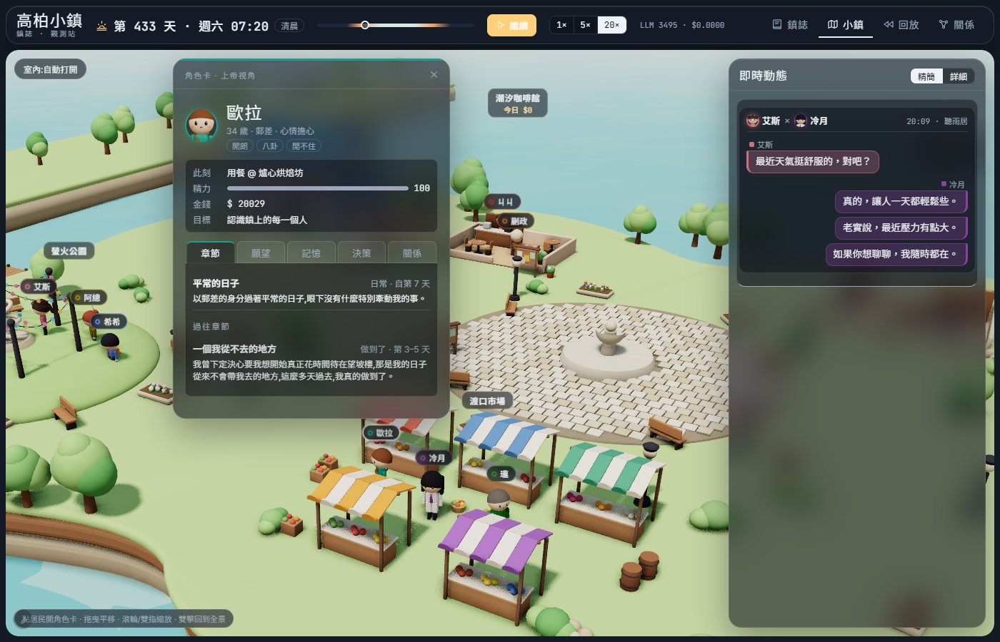 | B1 拖曳後<br>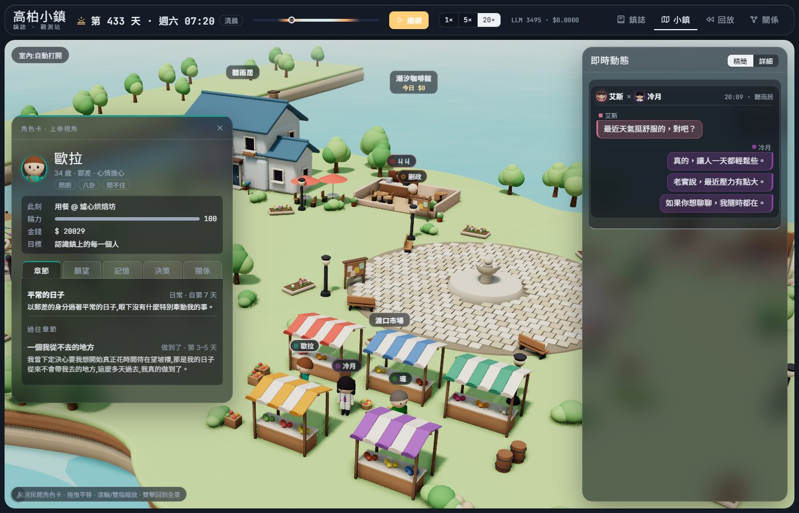 |
| B2 軌道旋轉,角度 A<br>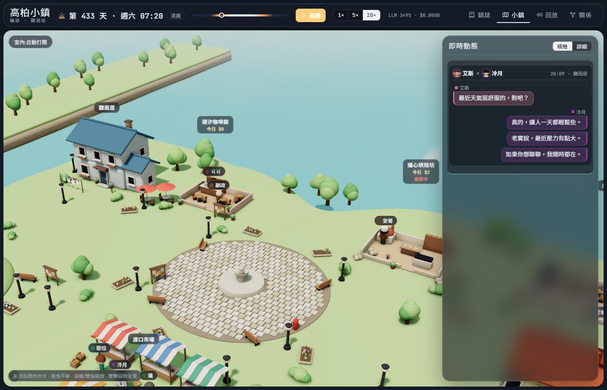 | B2 軌道旋轉,角度 B<br>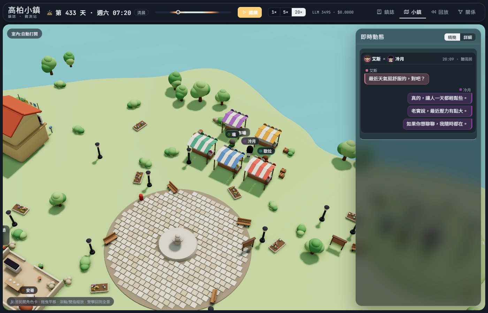 |
| B3 烘焙坊白天(沒有黑塊)<br>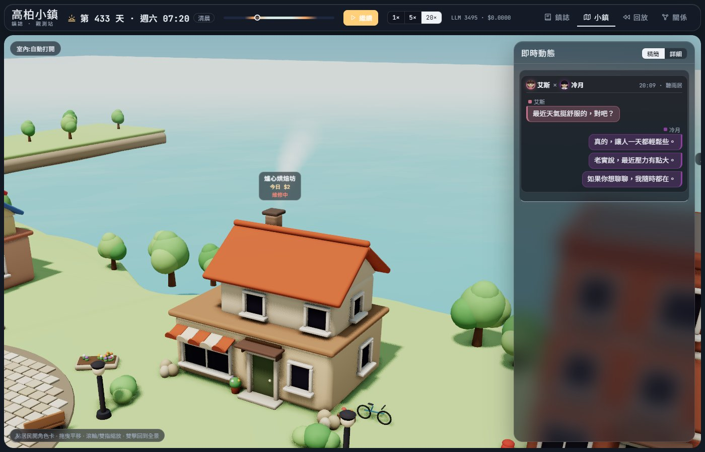 | B3 烘焙坊夜晚<br>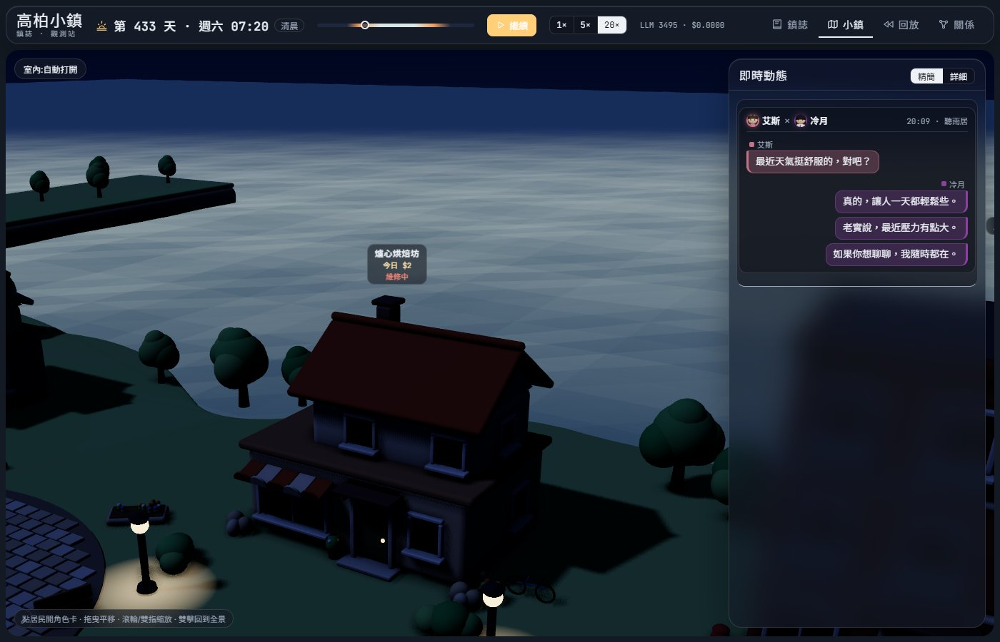 |
| B5 維運面板(桌機)<br>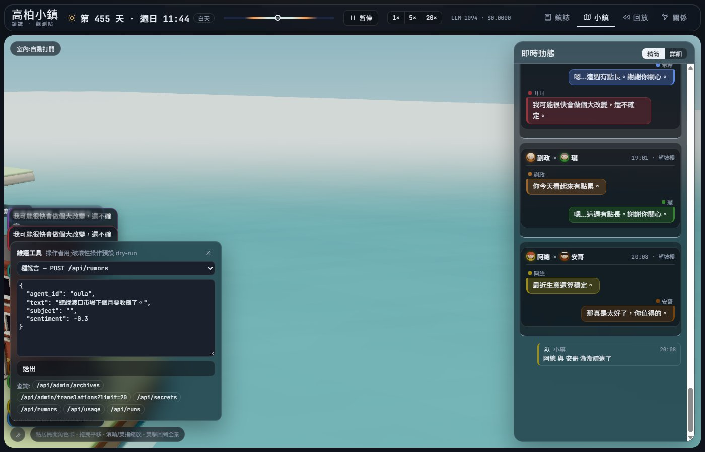 | B5 390px 寬<br> |
| B5 390px,抽屜打開<br>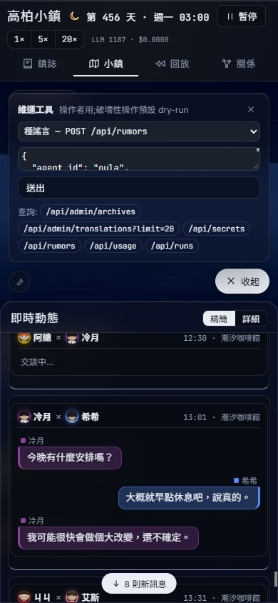 | 角色卡:心情與今日打算<br>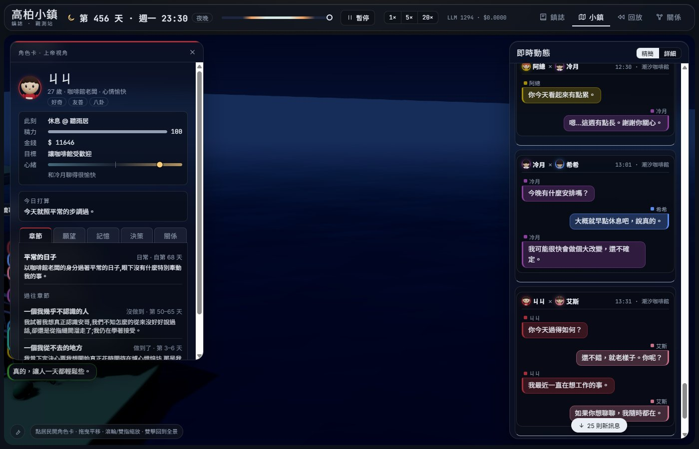 |
| 鎮誌(玻璃)<br>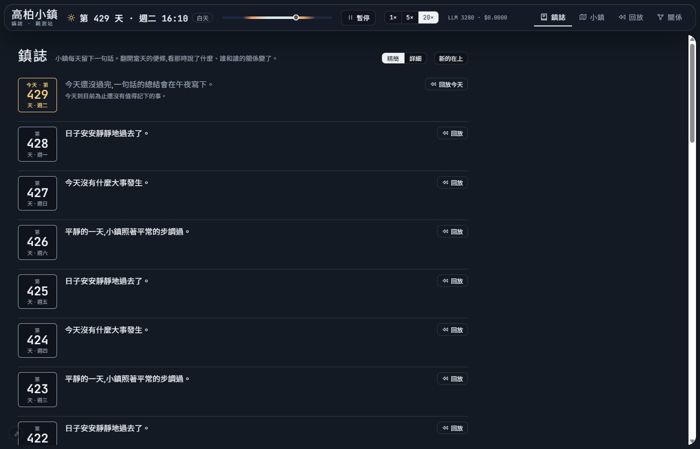 | 關係(玻璃)<br>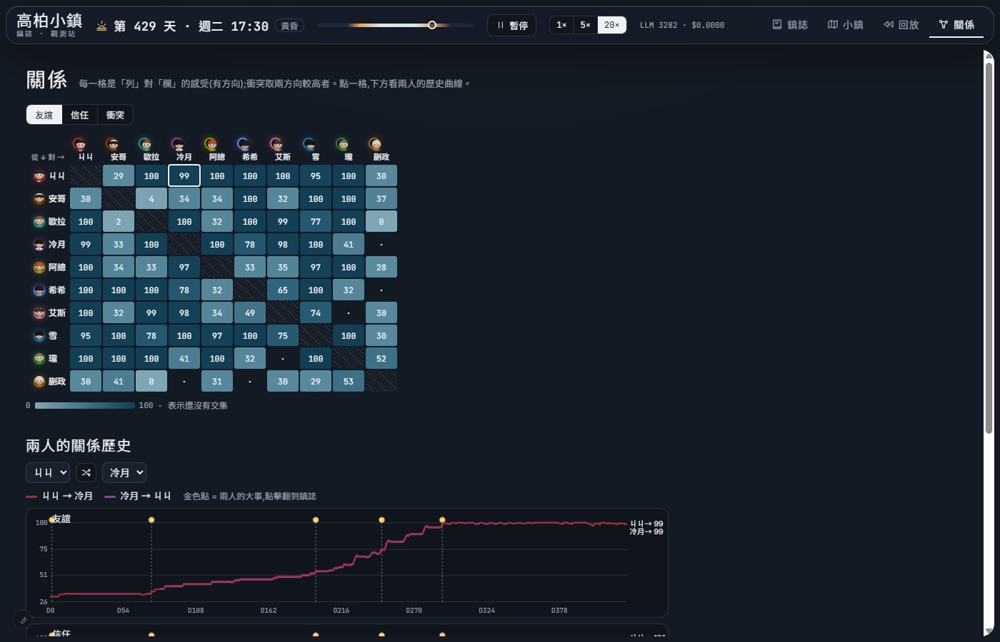 |
| 回放(3D)<br>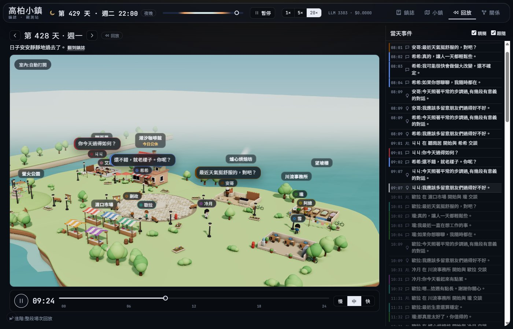 | 十人合照<br>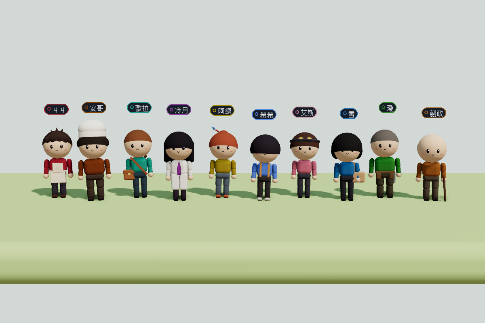 |

- **B4、B6 的證據是實測數字,不是截圖**。B4:相機朝 32° 和 212° 時按 W,都朝畫面前方移動 22.2 m,左右分量為 0。B6:在 30 m 和 90 m 兩個鏡頭距離下,每秒都移動約 0.86–0.87 個畫面寬。
- B3 截圖裡的居民位置是為了拍攝擺放的。

## Process 盤點(C1)

- 監聽中的連接埠(8000–8100):只有 **8010**。最後一次盤點(報告提交前)是 PID 28124;每次重啟只換 PID,始終只有一個。
- python 程序:1 個,就是正式 server。
- 曾經存在、已關閉的:8020 dev server(UI 子代理,已停)、8020 封存演練用的 server(驗證完就停)。
- `aitown-pg` Postgres 容器:資料庫本身,保留。

## 封存演練(D1)

- **正式 DB dry-run**(沒有改動任何東西):`archive_run.py --run 7b977300…` 會把 run `7b977300` 標成封存;它涵蓋 Day 1–40 的 12,830 個事件,並帶著它的快照。
- **scratch DB 實際執行**:
  1. 封存 scratch run `826e5ab2`(132,672 個事件)。快照先備份進 `snapshot_archive`(id=1),該 run 標成封存。
  2. 在 scratch 上開 server,log 寫著 `latest snapshot belongs to archived run … not continuing it; opening a new run`,從 Day 1 06:01 開了新 run。
  3. `/api/runs` 列出舊 run(已封存,132,672 個事件);`/api/history?run_id=…` 仍能讀出舊 run 的事件。三件事都對:不可 resume、開新 run、replay 保留。
  4. 驗證完就把 scratch server 停了。

## 點火三行(等你說 GO 才執行)

```
1) curl -X POST localhost:8010/api/control -H "content-type: application/json" -d '{"cmd":"pause"}'   # 確認 world_snapshots 落盤 → 停 server
2) python scripts/archive_run.py --run 7b977300485a4a72a25fe5098b135a9d --note "第二紀元(新紀元)Day 1–N,活化上線於 D39–46" --execute
3) 以同樣的環境變數(AI_TOWN_GATE_DIAG=1、AI_TOWN_BUDGET_USD=30)啟動 server → 自動開新 run Day 1 → 守望腳本的 RUN 改成新 run id 後重掛 → 回報第一份快照與模型鏈首
```

## 新 prompt 全文(最終版)

### 逐輪對話(task `dialogue_turn` / `dialogue_turn_tense`)

情境:ㄐㄐ 在潮汐咖啡館對冷月開口後,輪到冷月(第 2 句)。本例路由:`dialogue_turn_tense`(ㄐㄐ 有一顆以冷月為對象的願望)。

**system(兩個座位共用的模板,名字代入說話者)**

```text
You voice ONE character, 冷月, in a face-to-face conversation with ㄐㄐ in a life simulation, and write only 冷月's next spoken line. You know only what 冷月 knows: their own memories, feelings, plans and private matters (given below), plus whatever ㄐㄐ has said aloud. You cannot see into ㄐㄐ's head, and you never decide what ㄐㄐ feels, does or agrees to. Ground the line in the conversation so far and in 冷月's own life; when something real is on 冷月's mind, don't fall back on generic small talk. Keep 冷月's way of speaking, but don't open every line the same way or repeat a catchphrase line after line. Let the talk end when it naturally would: everyday chats between neighbours often wrap up in a few lines. Respond ONLY with JSON: {"text": "...", "end": true|false, "sentiment": 0..1, "trust_signal": 0..1, "conflict_signal": 0..1, "tells": "", "plan": null, "storm_off": false}
- text: what 冷月 says now, aloud, 1-3 short sentences.
- end: true when this line closes the conversation (a goodbye, or nothing left to say).
- sentiment / trust_signal / conflict_signal: how the exchange feels to 冷月 right now (warmth, growing trust, friction; each 0..1).
- tells: when this line gives ㄐㄐ a concrete piece of news they didn't have (something that happened, a plan, a worry 冷月 chose to share), restate it as one short third-person sentence; otherwise "".
- plan: only when 冷月 proposes, or agrees to, a concrete meeting with ㄐㄐ: {"place": "<place name>", "day": "today"|"tomorrow", "hour": 8-21}; otherwise null.
- storm_off: true only if 冷月 is upset enough to walk away mid-conversation; it ends the talk.
Referential anchor (critical): 冷月 speaks to ㄐㄐ directly as "you" (你/妳) or by name -- "you" and "ㄐㄐ" are the SAME person, so never put them side by side (never "你和ㄐㄐ" / "you and ㄐㄐ"); and 冷月 never refers to themselves in the third person by name. Do not invent concrete facts that aren't in the context (deadlines, sums of money, named events). The only people who exist in this town are: Jiji (ㄐㄐ), Ange (安哥), Oula (歐拉), Lengyue (冷月), Azong (阿總), Xixi (希希), Aisi (艾斯), Xue (雪), Long (瓏), Kuaizheng (蒯政). Refer to a person by exactly one of these names and never invent any other name. Each resident has a fixed gender -- use the matching pronouns for that person throughout (he/him/his for male, she/her/hers for female; 他/她) and never mis-gender anyone: ㄐㄐ is male, 安哥 is male, 歐拉 is male, 冷月 is female, 阿總 is female, 希希 is male, 艾斯 is female, 雪 is female, 瓏 is male, 蒯政 is male. Write every human-readable text value (e.g. "text", "insights") in natural Traditional Chinese (zh-TW). Keep all JSON keys and any action/enum values in English. When a spoken line names a person or place, use its Chinese name, never the English/pinyin form: people (Jiji=ㄐㄐ; Ange=安哥; Oula=歐拉; Lengyue=冷月; Azong=阿總; Xixi=希希; Aisi=艾斯; Xue=雪; Long=瓏; Kuaizheng=蒯政); places (Rainlisten House=聽雨居; Slopeview Flats=望坡樓; Tide Cafe=潮汐咖啡館; Hearth Bakery=爐心烘焙坊; Ferry Crossing Market=渡口市場; Riverrun Office=川流事務所; Firefly Park=螢火公園). Task: dialogue_turn.
```

**user(冷月的座位,第 2 句)**

```text
Scene: afternoon at 潮汐咖啡館.
Also here: 今天剛完成的窗邊一盆新種的薄荷.
You are 冷月, 36, 醫生. Traits: 冷靜, 敏銳, 樂於助人. 以醫生的身分過著平常的日子,眼下沒有什麼特別牽動我的事。 Speech style: 說話緩慢而精準;切入正題前,會先點出她從你身上讀到的狀態。 Your mood: neutral (a bit low) -- mostly because: 和艾斯的談話不太愉快.
To you, ㄐㄐ is someone you barely know.
Conversation so far:
ㄐㄐ: 冷月,今天這麼早下班?要不要坐一下,我請你喝杯咖啡。
This is line 2 of at most 8.
```

**user(ㄐㄐ 的座位,第 1 句)**——同一場對話,另一邊看到的完全是另一份私人脈絡

```text
Scene: afternoon at 潮汐咖啡館.
Also here: 今天剛完成的窗邊一盆新種的薄荷.
You are ㄐㄐ, 27, 咖啡館老闆. Traits: 好奇, 友善, 八卦. 以咖啡館老闆的身分過著平常的日子,眼下沒有什麼特別牽動我的事。 Speech style: 被問到自己的事時,總用一句玩笑帶過,再把話題丟回你身上,打聽你的近況(一部分是為了掩飾咖啡館的困境)。 Your mood: neutral (even).
To you, 冷月 is someone you barely know.
What you remember about 冷月:
- 雪提過她想辭掉工作。
- 我發現自己每天早上都期待阿總出現,期待的程度超過我願意承認的。
- 雪喜歡喝黑咖啡。
What you want right now (your own; nobody else knows unless you say it):
- [minor] 請冷月喝杯咖啡: 我想找機會好好請冷月喝一杯咖啡,謝謝她上次幫忙。
Private matters (yours alone -- share only if it truly fits the moment):
- 咖啡館只能勉強打平;我每天都裝出一副很有自信的樣子。
Nobody has spoken yet -- you open.
This is line 1 of at most 8. Don't end on this line; let 冷月 answer.
```

### 起床微決策(task `day_plan`)

情境:雪,種子章節已跑 5 天沒有任何進展。

**system**

```text
You decide how ONE resident of a small town, 雪, wants to spend today, as they wake up. Most days are ordinary and that is fine: if nothing pulls at 雪, say so (nothing_special: true) and keep the usual day. When something does -- yesterday, a mood, a wish, a promise, a chapter that has stalled -- let it shape today in a small, concrete way. You decide only 雪's own day: never what anyone else does or feels, and sleep is not yours to change. Respond ONLY with JSON: {"intent": "...", "nothing_special": true|false, "skip_work": 0..1, "slots": [{"from": 14, "to": 16, "place": "<place name>", "doing": "visit|rest|idle|work|eat"}], "actions": [{"hour": 15, "place": "<place name>", "what": "...", "leaves": "", "cost": 0}]}
- intent: one first-person sentence: how they mean to spend today, and why.
- slots: at most 3 changes to the usual day, whole hours from 7 to 22, each at most 4 hours; [] when nothing changes. "visit" means spending time at a place.
- skip_work: how much they want to skip work today, honestly (0 = not at all). Only meaningful on a work day.
- actions: at most 2 small things they want to DO today, by themselves, beyond where they spend time -- sketch something, tidy or plant something, put up a notice, try something new. "what" is a short phrase of what they do, without the subject; "leaves" is something it leaves behind in that place for others to see, short, or ""; "cost" is the money it takes (0 if none). Only their own doing: it may involve someone -- waiting for them somewhere, leaving them a note, a small gift or an invitation ("leaves" is then that thing, and they will find it themselves) -- but it never decides another person's response or outcome (not "make up with X", not "get X to agree"), never handles their belongings or body, and never enters someone else's home. Tell every action from their own side only, as what they set out to do: "去找安哥,想一起看接線" is fine, "跟安哥一起看了接線" is not -- whether the other person is there and joins in is up to the world. A greeting or a chat is not an action: just say whom they go to find. It may fall inside a stretch they already spend at that place. [] when nothing. The only people who exist in this town are: Jiji (ㄐㄐ), Ange (安哥), Oula (歐拉), Lengyue (冷月), Azong (阿總), Xixi (希希), Aisi (艾斯), Xue (雪), Long (瓏), Kuaizheng (蒯政). Refer to a person by exactly one of these names and never invent any other name. Each resident has a fixed gender -- use the matching pronouns for that person throughout (he/him/his for male, she/her/hers for female; 他/她) and never mis-gender anyone: ㄐㄐ is male, 安哥 is male, 歐拉 is male, 冷月 is female, 阿總 is female, 希希 is male, 艾斯 is female, 雪 is female, 瓏 is male, 蒯政 is male. Write every human-readable text value (e.g. "text", "insights") in natural Traditional Chinese (zh-TW). Keep all JSON keys and any action/enum values in English. When a spoken line names a person or place, use its Chinese name, never the English/pinyin form: people (Jiji=ㄐㄐ; Ange=安哥; Oula=歐拉; Lengyue=冷月; Azong=阿總; Xixi=希希; Aisi=艾斯; Xue=雪; Long=瓏; Kuaizheng=蒯政); places (Rainlisten House=聽雨居; Slopeview Flats=望坡樓; Tide Cafe=潮汐咖啡館; Hearth Bakery=爐心烘焙坊; Ferry Crossing Market=渡口市場; Riverrun Office=川流事務所; Firefly Park=螢火公園). Task: day_plan.
```

**user**

```text
Today is Day 6, Saturday. It is your day off.
You are 雪, 31, 上班族. Traits: 安靜, 忠誠, 焦慮. 我正在默默考慮要不要辭掉工作——辦公室讓我身心俱疲,我還沒決定要往哪邊跳。 Your mood: neutral (even). By nature you are very dutiful. Money on hand: 100.
Your usual day:
- 09:00-10:30 eat at 望坡樓
- 10:30-12:00 rest at 潮汐咖啡館
- 12:00-14:00 eat at 潮汐咖啡館
- 14:00-16:30 rest at 渡口市場
- 16:30-19:00 rest at 螢火公園
- 19:00-22:30 eat at 望坡樓
This chapter of your life has run 5 days, and nothing in it has moved -- it is stuck.
Places in town: 望坡樓, 潮汐咖啡館, 爐心烘焙坊, 渡口市場, 川流事務所, 螢火公園.
Things people have left around town:
- 新落成的窗邊一盆新種的薄荷 (潮汐咖啡館)
How does 雪 want to spend today?
```

